# Manual de usuario
## Sistema de Asesorías Académicas FCQI

Facultad de Ciencias Químicas e Ingeniería · Universidad Autónoma de Baja California

Este manual explica, paso a paso y con imágenes, cómo usar el Sistema de
Asesorías Académicas. No necesitas saber nada de computación: si sabes abrir
una página de internet, puedes seguirlo.

---

## Contenido

1. [¿Qué es este sistema?](#1-qué-es-este-sistema)
2. [Antes de empezar](#2-antes-de-empezar)
3. [Conoce la pantalla](#3-conoce-la-pantalla)
4. [Buscar una asesoría (sin cuenta)](#4-buscar-una-asesoría-sin-cuenta)
5. [Entrar al sistema](#5-entrar-al-sistema)
6. [Si eres alumno](#6-si-eres-alumno)
7. [Si eres asesor](#7-si-eres-asesor)
8. [Si eres alumno y también asesor](#8-si-eres-alumno-y-también-asesor)
9. [Si eres de dirección](#9-si-eres-de-dirección)
10. [Usarlo en el celular](#10-usarlo-en-el-celular)
11. [Salir del sistema](#11-salir-del-sistema)
12. [Preguntas frecuentes y problemas comunes](#12-preguntas-frecuentes-y-problemas-comunes)
13. [Palabras que verás en el sistema](#13-palabras-que-verás-en-el-sistema)

---

## 1. ¿Qué es este sistema?

Es una página para **pedir y organizar asesorías académicas** de la facultad.

- Los **alumnos** buscan una materia, eligen a un asesor y piden una cita.
- Los **asesores** (profesores o alumnos que asesoran) aceptan o rechazan las
  citas, publican sus horarios y anotan cómo les fue.
- **Dirección** decide qué materias atiende cada asesor y consulta reportes.

Una **asesoría** es una reunión con un asesor para resolver dudas de una
materia. Puede ser **presencial** (en un cubículo de la facultad) o **virtual**
(por videollamada).

---

## 2. Antes de empezar

Necesitas:

- Una computadora, tableta o celular con internet.
- Un navegador actualizado: **Chrome**, **Safari**, **Edge** o **Firefox**.
- Tu **correo institucional** que termina en **@uabc.edu.mx**.
- La **dirección de la página**, que te da la coordinación del programa de
  asesorías.

> **Importante:** solo pueden entrar las personas que la coordinación dio de
> alta en el programa. Si tu correo no funciona, escribe a
> **progasesorias.fcqi@uabc.edu.mx**.

Al abrir la página verás un momento el texto «Cargando asesorías…» sobre fondo
verde. Es normal: espera unos segundos.

---

## 3. Conoce la pantalla

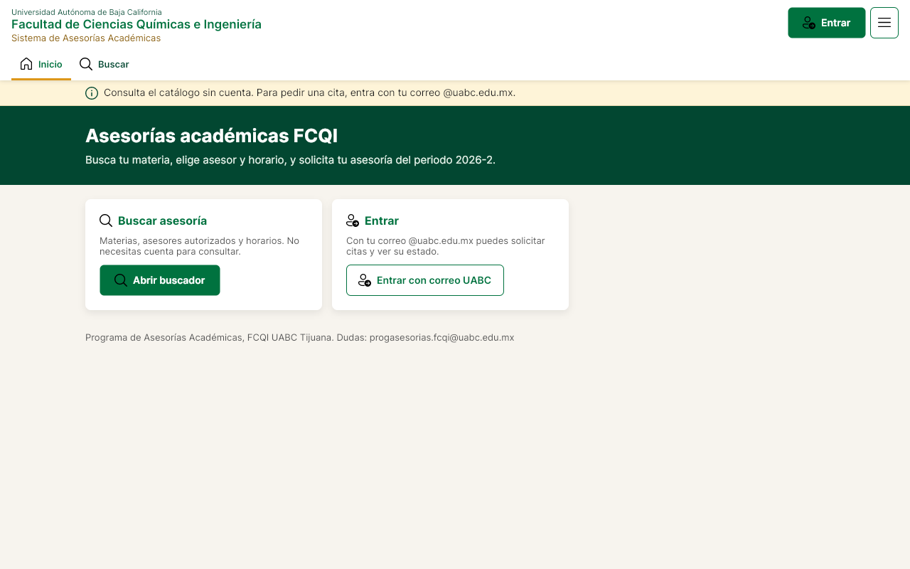

La pantalla tiene siempre las mismas partes:

| Parte | Dónde está | Para qué sirve |
|-------|-----------|----------------|
| **Nombre de la facultad** | Arriba a la izquierda | Te confirma que estás en el sistema correcto. |
| **Menú de secciones** | Debajo del nombre (Inicio, Buscar…) | Te lleva a cada sección. La sección en la que estás se subraya en naranja. |
| **Botón «Entrar»** | Arriba a la derecha (verde) | Abre la pantalla para entrar con tu correo. Desaparece cuando ya entraste. |
| **Botón ☰ (tres rayas)** | Arriba a la derecha | Abre el menú de opciones: tamaño de letra, tu nombre, tu rol y «Salir». |
| **Franja amarilla de avisos** | Debajo del menú | Te dice qué pasó con lo último que hiciste («Solicitud enviada», «Asesoría cancelada»…). **Léela siempre.** |

Las secciones del menú cambian según quién seas: un alumno ve «Mis asesorías»,
un asesor ve «Solicitudes» y «Mis horarios», y dirección ve «Dirección» y
«Reportes».

### Cambiar el tamaño de la letra

Si las letras te parecen muy chicas o muy grandes:

1. Toca el botón **☰** (arriba a la derecha).
2. En **«Tamaño de letra»** usa la lupa con **+** para agrandar o la lupa con
   **−** para achicar.
3. Toca el número del centro (por ejemplo, **100 %**) para volver al tamaño
   normal.

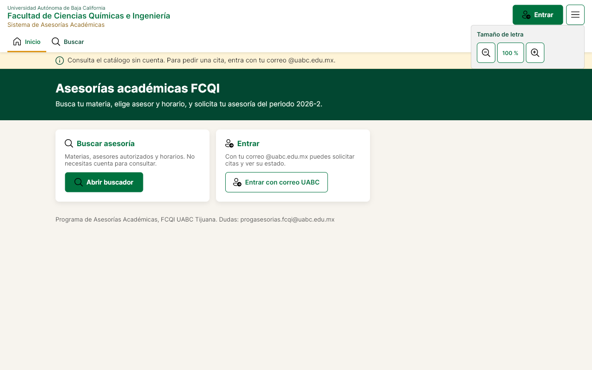

El sistema recuerda el tamaño que elegiste la próxima vez que entres desde ese
mismo navegador.

---

## 4. Buscar una asesoría (sin cuenta)

Puedes **consultar** materias, asesores y horarios **sin entrar** con tu
correo. Solo necesitas entrar al momento de **pedir** la cita.

La búsqueda tiene **tres pasos**, que ves como botones arriba:
**1 Materia → 2 Asesor → 3 Horario y fecha**.

### Paso 1: elige la materia

1. Toca **«Buscar»** en el menú (o el botón **«Abrir buscador»** de la
   pantalla de inicio).
2. Verás la lista de materias.

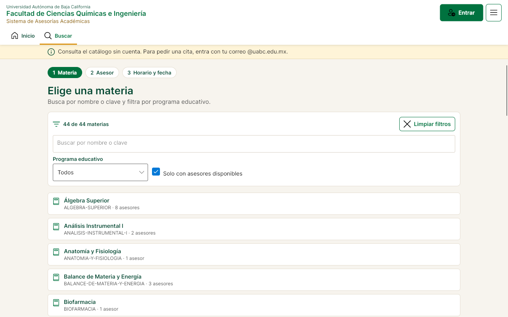

3. Para encontrar tu materia más rápido, **escribe parte de su nombre** en el
   recuadro «Buscar por nombre o clave». La lista se reduce mientras escribes.

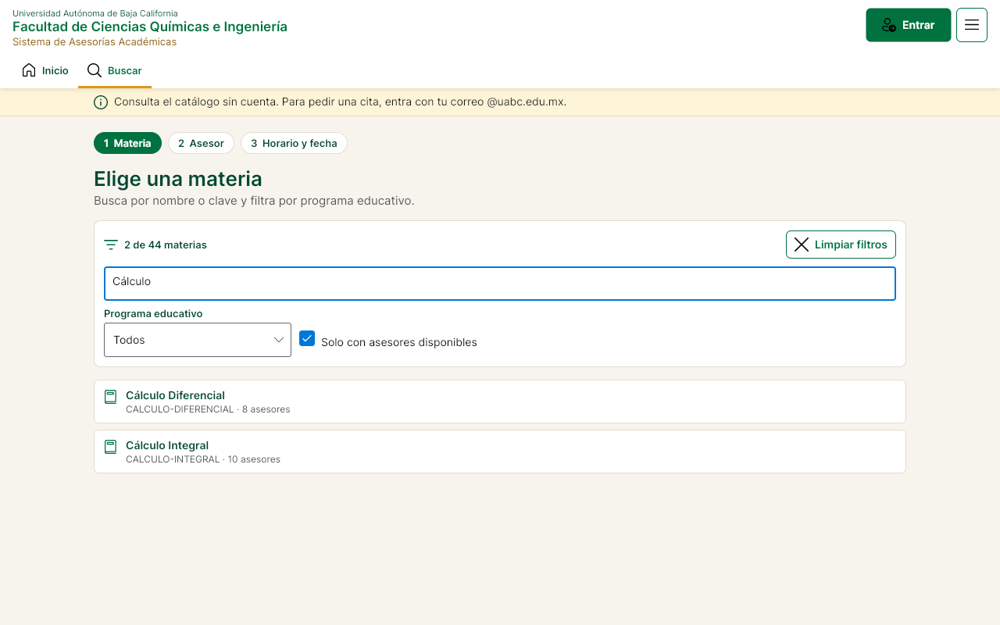

Otras ayudas en este paso:

- **Programa educativo:** muestra solo las materias de tu carrera.
- **Solo con asesores disponibles:** si está marcado (✓), oculta las materias
  que todavía no tienen asesor.
- **Limpiar filtros:** borra todo lo que escribiste o elegiste y vuelve a
  mostrar todas las materias.
- El texto **«2 de 44 materias»** te dice cuántas se ven con tus filtros y
  cuántas hay en total.

4. **Toca la materia** que quieres.

### Paso 2: elige al asesor

Verás a los asesores que atienden esa materia. Cada uno muestra si es
**Profesor** o **Estudiante**, su carrera, qué días atiende y cuántas horas a la
semana.

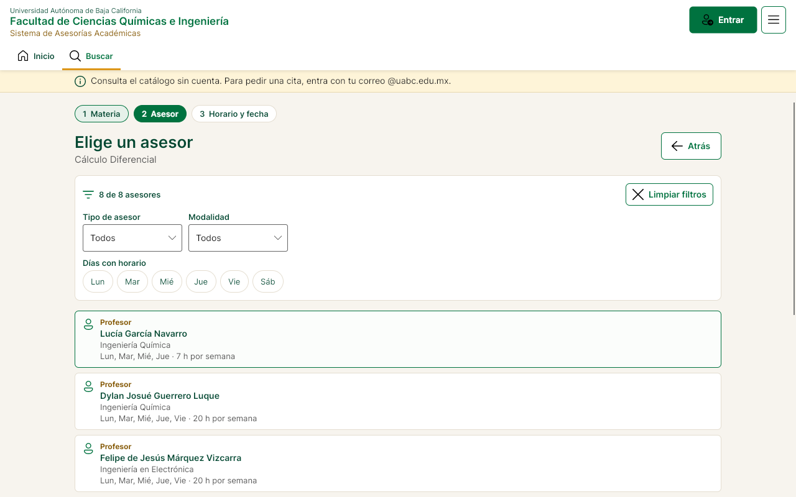

Puedes filtrar por:

- **Tipo de asesor:** Profesor o Estudiante.
- **Modalidad:** Presencial o Virtual.
- **Días con horario:** toca los días que te acomodan (Lun, Mar…). Se marcan
  al tocarlos; tócalos otra vez para desmarcarlos.

**Toca al asesor** que prefieras. Si te equivocaste, usa el botón **«Atrás»**.

### Paso 3: elige el horario y la fecha

Verás los horarios semanales del asesor: el día, la hora, si es presencial o
virtual y el lugar.

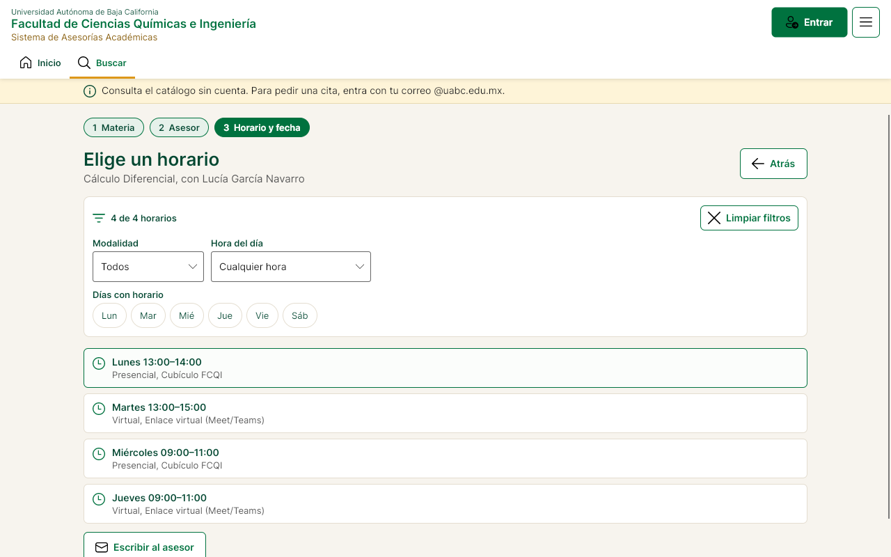

1. **Toca el horario** que te acomode. Se marca con un borde naranja y aparece
   el recuadro **«Solicitar este horario»**.
2. En **«Fecha de la asesoría»** el sistema ya propone la fecha más próxima.
   Si quieres otra, toca el recuadro de la fecha y elige en el calendario. El
   calendario **solo deja elegir los días** en que ese asesor tiene ese horario;
   los demás días aparecen en gris.
3. En **«¿Qué quieres repasar?»** escribe brevemente tu duda o tema (por
   ejemplo, «Ejercicios de derivadas del parcial»). Esto ayuda al asesor a
   prepararse.

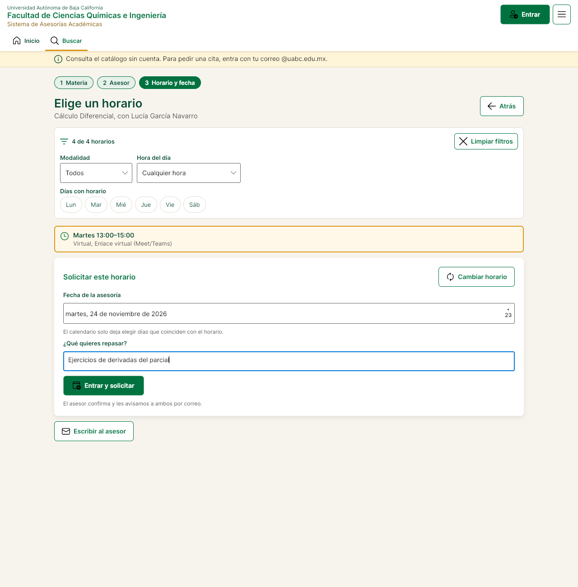

4. Si todavía no entraste con tu correo, el botón dice **«Entrar y
   solicitar»**. Al tocarlo, el sistema te pide entrar (ver la sección 5).

> **¿Tienes una duda antes de pedir la cita?** Usa el botón
> **«Escribir al asesor»** (debajo del formulario). Tu mensaje le llega a su
> correo y te responde al tuyo. Necesitas haber entrado con tu correo.

---

## 5. Entrar al sistema

1. Toca el botón verde **«Entrar»** (arriba a la derecha).
2. Escribe tu **correo institucional** completo en «Correo institucional»
   (por ejemplo, `nombre.apellido@uabc.edu.mx`).
3. Toca **«Entrar»**.

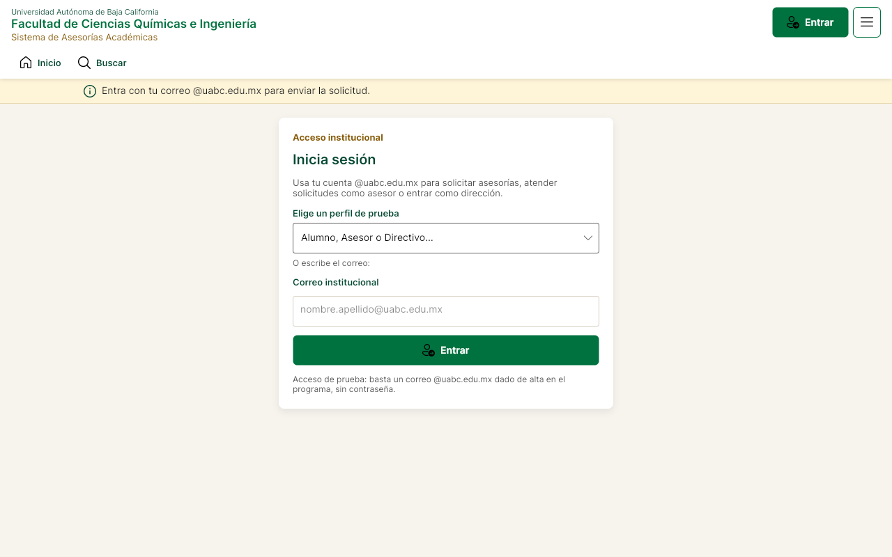

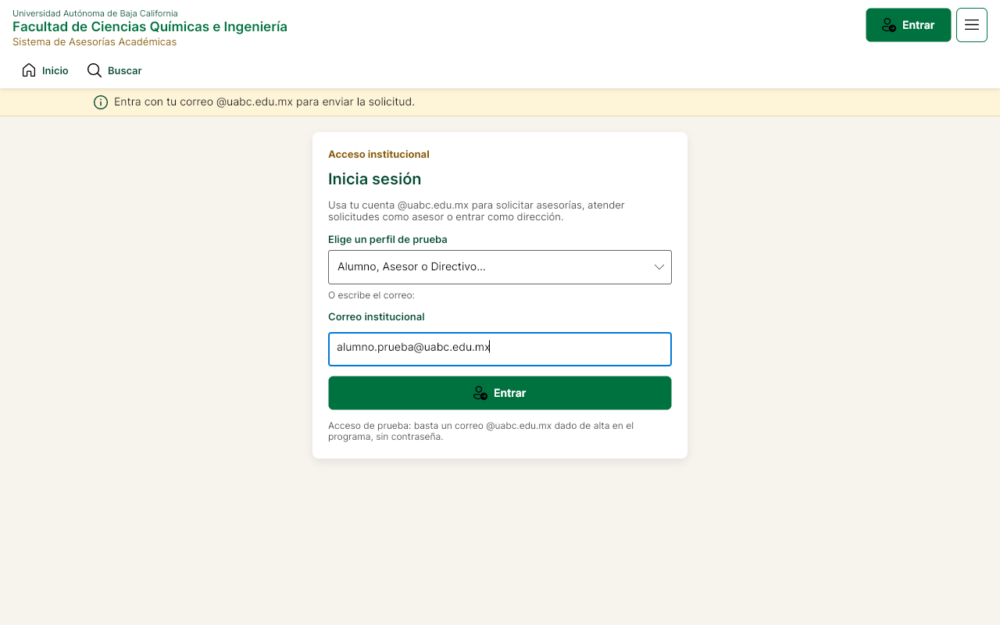

**Si algo sale mal**, el sistema te lo dice en rojo debajo del correo:

- «Escribe tu correo institucional @uabc.edu.mx»: el recuadro quedó vacío.
- «Solo se aceptan cuentas @uabc.edu.mx»: usaste otro correo (Gmail, Hotmail…).
- «El correo UABC no está dado de alta en el programa de asesorías»: tu correo
  es correcto, pero la coordinación todavía no te registró. Escribe a
  **progasesorias.fcqi@uabc.edu.mx**.

> **Etapa de pruebas:** por ahora el sistema **no pide contraseña** y muestra
> también una lista «Elige un perfil de prueba» con cuentas de ejemplo. Esto es
> temporal, mientras se conecta con las cuentas oficiales de la universidad.

Para saber con qué cuenta entraste, toca **☰**: arriba dice **«Conectado
como»**, tu nombre y tu rol.

---

## 6. Si eres alumno

Al entrar como alumno, el menú muestra **Inicio**, **Buscar** y **Mis
asesorías**.

### 6.1 Pedir una asesoría

1. Sigue los tres pasos de la [sección 4](#4-buscar-una-asesoría-sin-cuenta):
   materia, asesor y horario.
2. Revisa la fecha y escribe tu tema en «¿Qué quieres repasar?».
3. Toca **«Solicitar asesoría»**.

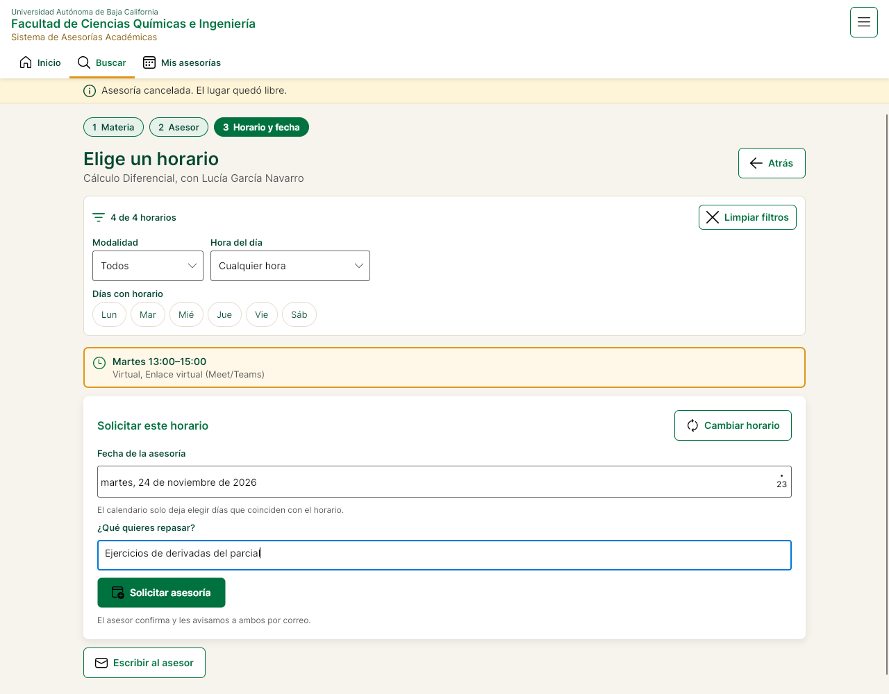

El sistema te lleva solo a **«Mis asesorías»** y la franja amarilla confirma:
*«Solicitud enviada para el … Queda pendiente hasta que el asesor la
confirme»*.

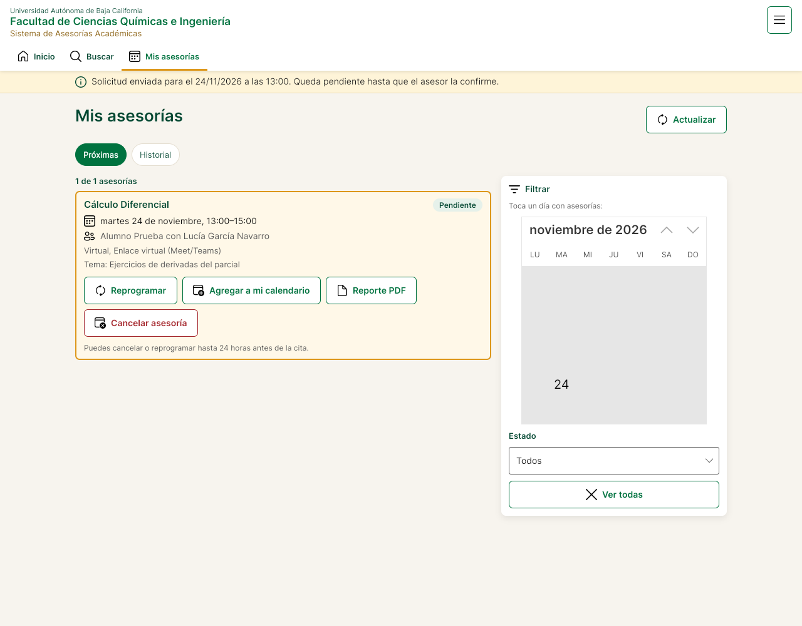

Tu cita aparece como **Pendiente**. Cuando el asesor la acepte, cambiará a
**Confirmada**. A ti y al asesor les llega un aviso por correo cada vez que la
cita cambia.

> **Consejo:** si entraste a mitad de una búsqueda (con el botón «Entrar y
> solicitar»), el sistema te regresa al buscador. Si ves el aviso *«Elige
> materia, asesor, horario y fecha»*, vuelve a tocar el horario y después
> **«Solicitar asesoría»**.

### 6.2 Ver mis asesorías

Toca **«Mis asesorías»** en el menú. Hay dos pestañas:

- **Próximas:** tus citas que todavía no pasan (pendientes y confirmadas),
  de la más cercana a la más lejana.
- **Historial:** las citas que ya pasaron o que se cerraron (realizadas,
  canceladas o rechazadas).

A la derecha (o abajo, en el celular) está el recuadro **«Filtrar»**:

- En el **calendario** solo puedes tocar los días en que tienes citas. Al
  tocar uno, la lista muestra solo las de ese día.
- **Estado:** muestra solo las citas de un estado (por ejemplo, solo
  «Confirmada»).
- **Ver todas:** quita los filtros.
- **Actualizar** (arriba): vuelve a cargar la lista, por si el asesor acaba de
  confirmar.

**Toca una cita** para ver lo que puedes hacer con ella:

| Botón | Qué hace |
|-------|----------|
| **Reprogramar** | Cambia la cita a otro horario o fecha con el mismo asesor. |
| **Agregar a mi calendario** | Descarga un archivo que puedes abrir para guardar la cita en el calendario de tu celular, Google Calendar u Outlook. |
| **Reporte PDF** | Descarga un comprobante de la cita con todos sus datos. |
| **Unirme a la reunión** | Solo en citas virtuales confirmadas: abre la videollamada. |
| **Cancelar asesoría** | Cancela la cita y libera el lugar para otro alumno. |

### 6.3 Reprogramar una cita

1. En **Mis asesorías → Próximas**, toca la cita.
2. Toca **«Reprogramar»**.
3. En **«Nuevo horario con el mismo asesor»** elige el horario.
4. En **«Nueva fecha»** elige el día en el calendario.
5. Toca **«Reprogramar asesoría»**.

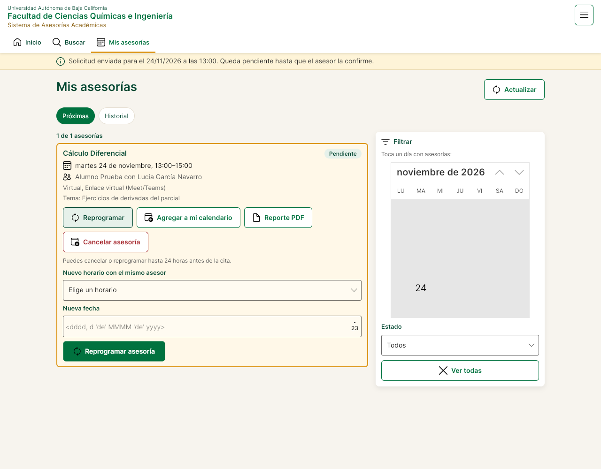

La cita anterior queda **Cancelada** y la nueva queda **Pendiente**: el asesor
tiene que volver a confirmarla.

### 6.4 Cancelar una cita

1. En **Mis asesorías → Próximas**, toca la cita.
2. Toca **«Cancelar asesoría»** (botón con letras rojas).

> **Atención:** la cita se cancela **en cuanto tocas el botón**; el sistema no
> te pregunta «¿estás seguro?» y una cita cancelada **no se puede recuperar**.
> Si la necesitas otra vez, tendrás que pedirla de nuevo.

**Regla de las 24 horas:** solo puedes cancelar o reprogramar **hasta 24 horas
antes** de la cita. Si falta menos, el sistema no te deja; avisa a tu asesor
con «Escribir al asesor».

### 6.5 Consultar el historial

En **Mis asesorías**, toca la pestaña **«Historial»**. Al tocar una cita puedes
descargar su **Reporte PDF**, útil como comprobante.

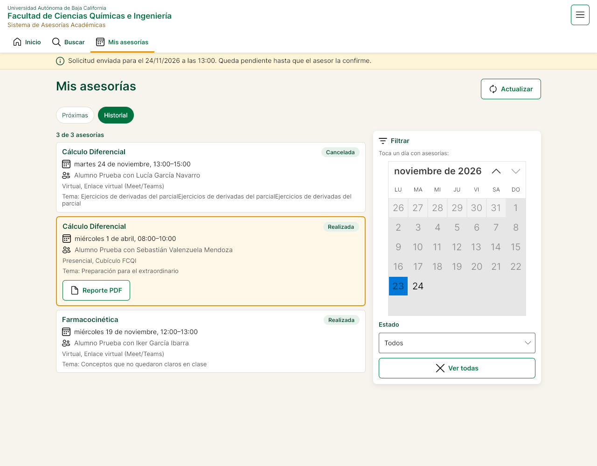

### 6.6 Qué significa cada estado

| Estado | Qué significa | ¿Qué sigue? |
|--------|---------------|-------------|
| **Pendiente** | Pediste la cita y el asesor todavía no responde. | Espera la confirmación (te llega por correo). |
| **Confirmada** | El asesor aceptó. | Asiste el día y la hora indicados. |
| **Rechazada** | El asesor no puede atenderte en ese horario. | Busca otro horario u otro asesor. |
| **Cancelada** | Tú o el asesor cancelaron la cita. | Pide una nueva si la necesitas. |
| **Realizada** | La asesoría ya se dio y el asesor la registró. | Nada; queda en tu historial. |

---

## 7. Si eres asesor

Al entrar como asesor, el menú muestra **Inicio**, **Buscar**, **Solicitudes**
y **Mis horarios**.

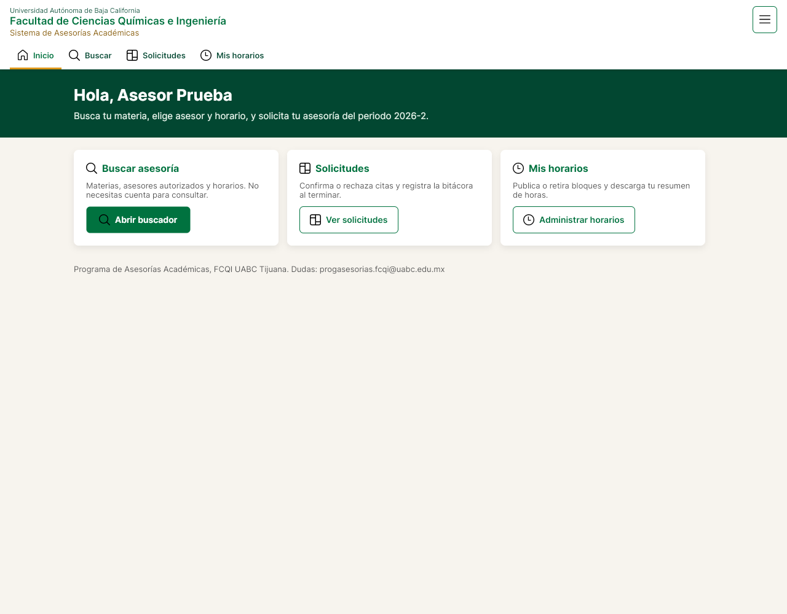

### 7.1 Revisar las solicitudes

Toca **«Solicitudes»**. Verás las citas que te pidieron, con la materia, la
fecha, el alumno, el lugar y el tema.

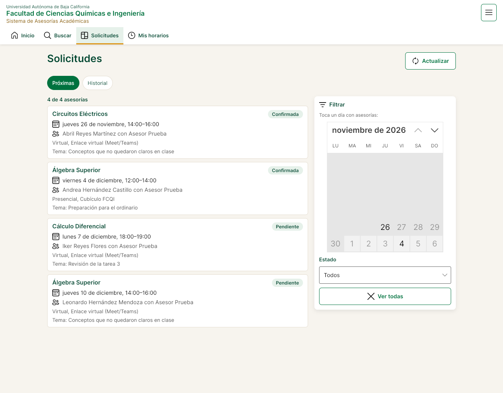

- **Próximas:** las citas que vienen.
- **Historial:** las que ya pasaron o se cerraron.

### 7.2 Confirmar o rechazar una solicitud

1. Toca una solicitud **Pendiente**.
2. Toca **«Confirmar»** (verde) si puedes atenderla, o **«Rechazar»** si no.

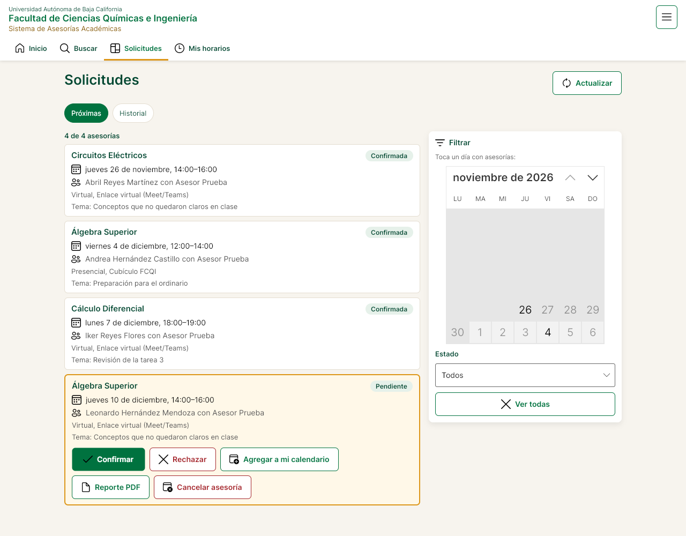

La franja amarilla confirma *«Asesoría confirmada. Avisamos al alumno.»* y la
cita cambia a **Confirmada**. El alumno recibe un correo.

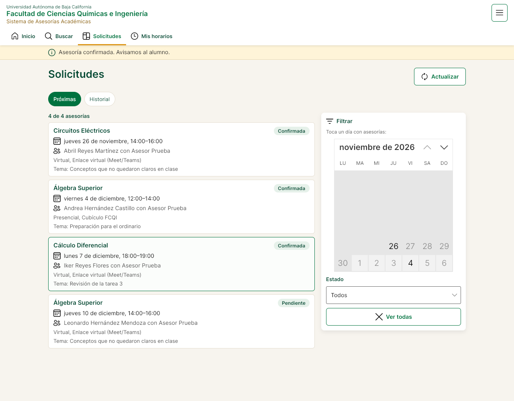

Si la cita es **virtual**, al confirmarla se agrega el enlace de la
videollamada y aparece el botón **«Unirme a la reunión»**.

> Como asesor puedes **cancelar** una cita confirmada en cualquier momento (sin
> la regla de 24 horas). Úsalo solo si de verdad no podrás atender: el alumno
> recibe un aviso.

### 7.3 Registrar la bitácora (al terminar la asesoría)

Cuando termines una asesoría, registra si el alumno asistió y qué vieron.
Esto la marca como **Realizada** y cuenta para tus horas.

1. En **Solicitudes → Historial**, toca la cita **Confirmada** que ya se dio.
2. Toca **«Registrar bitácora»**.
3. Deja marcada la casilla **«El alumno asistió»** si se presentó; desmárcala
   si no llegó.
4. Escribe en el recuadro el avance: temas vistos y pendientes.
5. Toca **«Guardar bitácora»**.

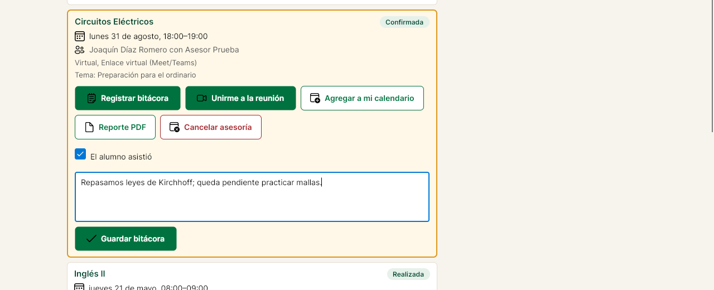

> El botón «Registrar bitácora» solo aparece **cuando la cita ya empezó**. Las
> horas de asesoría **solo cuentan** si el alumno asistió.

### 7.4 Publicar mis horarios

Toca **«Mis horarios»**. A la izquierda ves tus horarios publicados; a la
derecha, el recuadro para crear uno nuevo. Arriba se indica el total de horas
por semana.

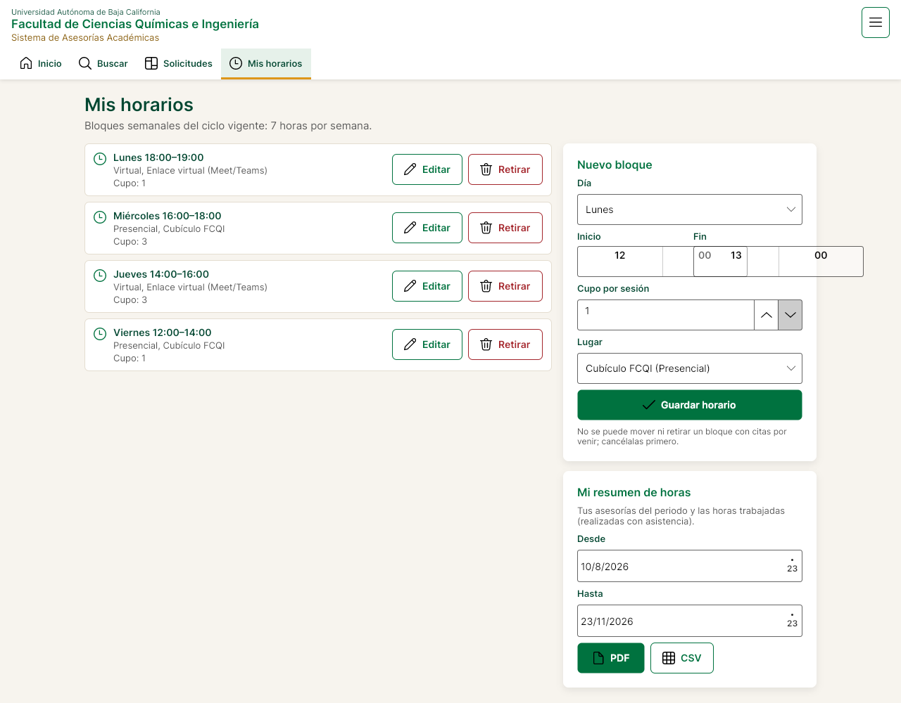

**Para crear un horario nuevo:**

1. En **«Nuevo bloque»**, elige el **Día**.
2. Ajusta la hora de **Inicio** y de **Fin**.
3. En **«Cupo por sesión»**, indica cuántos alumnos pueden asistir a la vez
   (de 1 a 30).
4. En **«Lugar»**, elige el cubículo o el enlace virtual.
5. Toca **«Guardar horario»**.

Los alumnos lo ven en el buscador desde ese momento.

**Para cambiar un horario:** toca **«Editar»** en ese horario, cambia lo que
necesites en el recuadro **«Editar bloque»** y toca **«Guardar horario»**. Si
te arrepientes, toca **«Cancelar edición»**.

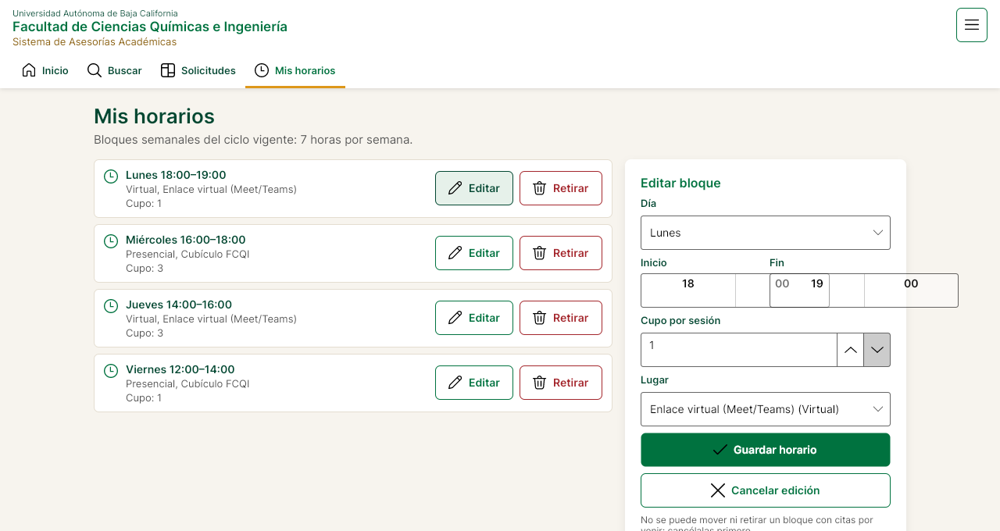

**Para quitar un horario:** toca **«Retirar»**.

> **No puedes mover ni retirar un horario que tiene citas por venir.**
> Primero atiende o cancela esas citas. Tampoco puedes bajar el cupo por
> debajo de los alumnos que ya apartaron lugar.

### 7.5 Descargar mi resumen de horas

En **Mis horarios**, recuadro **«Mi resumen de horas»**:

1. Elige las fechas **Desde** y **Hasta**.
2. Toca **«PDF»** (para imprimir o entregar) o **«CSV»** (para abrir en Excel).

El resumen incluye tus asesorías del periodo y las **horas trabajadas** (solo
las asesorías realizadas en las que el alumno asistió).

---

## 8. Si eres alumno y también asesor

Algunos alumnos también dan asesorías. Si es tu caso, tu cuenta tiene **dos
roles** y puedes cambiar de uno a otro **sin salir**:

1. Toca **☰** (arriba a la derecha).
2. En **«Entrar como»**, elige **Asesor** o **Alumno**.

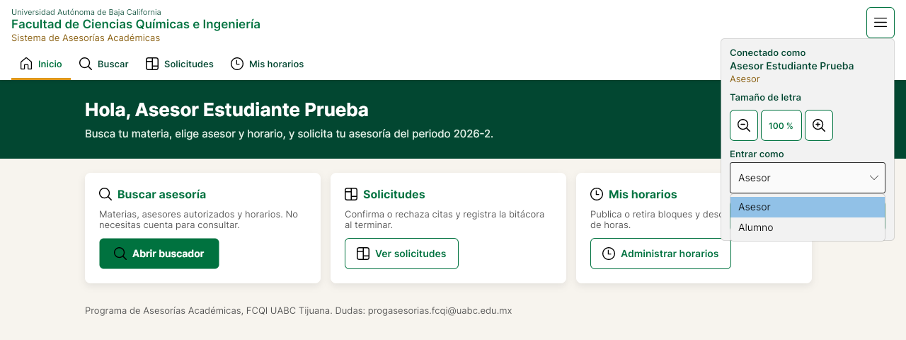

El menú de secciones cambia al momento. Como **Alumno** ves «Mis asesorías» y
puedes pedir citas; como **Asesor** ves «Solicitudes» y «Mis horarios».

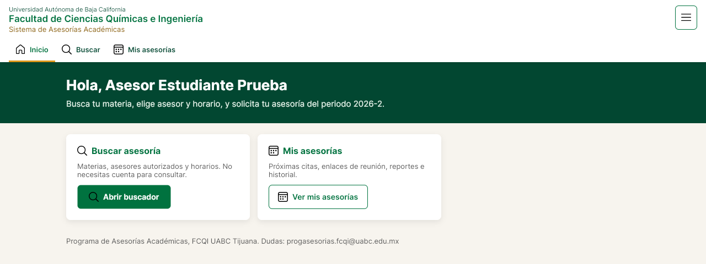

> No puedes pedirte una asesoría a ti mismo: el sistema lo impide.

Si solo tienes un rol, la opción «Entrar como» no aparece.

---

## 9. Si eres de dirección

Al entrar como dirección, el menú muestra **Inicio**, **Buscar**, **Dirección**
y **Reportes**.

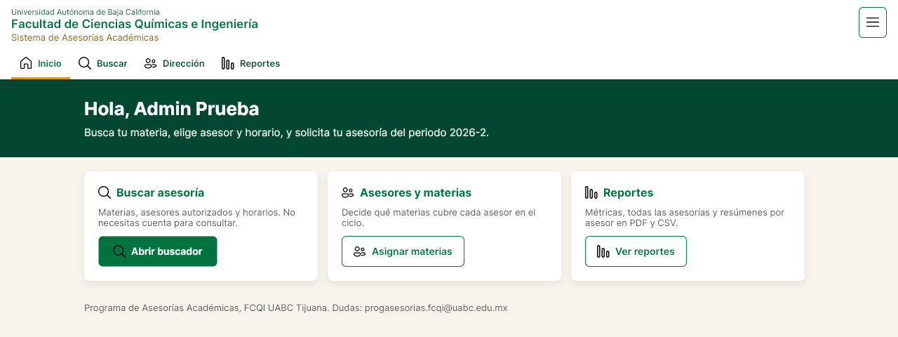

### 9.1 Asignar materias a los asesores

En esta sección decides **qué materias atiende cada asesor** en el ciclo
escolar. Los alumnos solo encuentran a un asesor en las materias que le
asignaste.

1. Toca **«Dirección»**.
2. En la lista de la izquierda, **toca al asesor**. Puedes buscarlo por nombre
   o correo, o filtrar por tipo (Profesor o Estudiante).

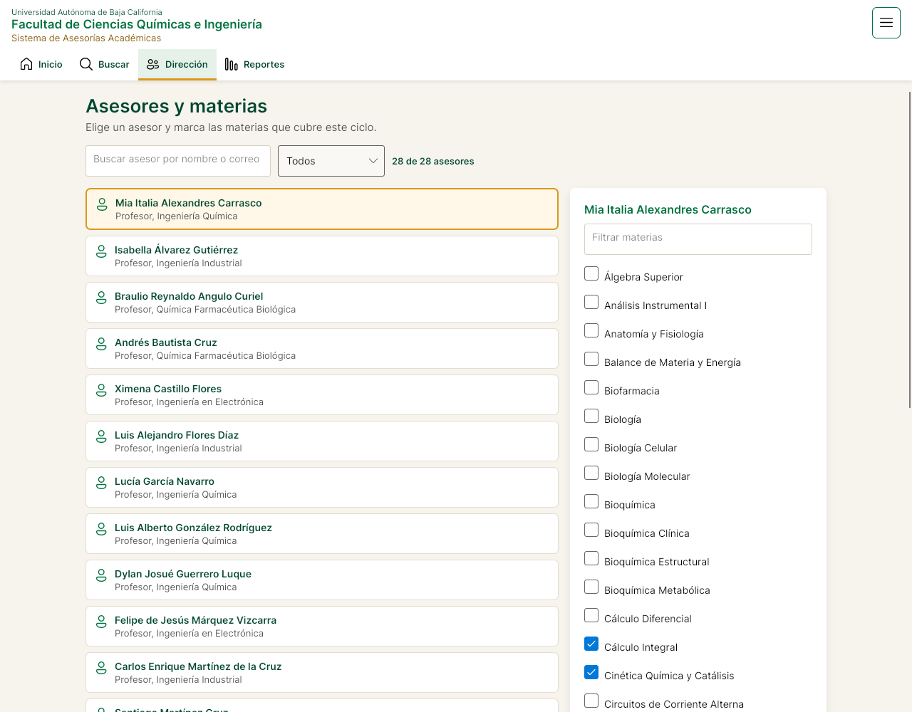

3. A la derecha aparecen todas las materias. **Marca (✓)** las que atiende y
   **desmarca** las que ya no.
4. Si la lista es larga, escribe en **«Filtrar materias»** para encontrar una.
   Las materias ya marcadas siempre se siguen viendo.
5. Toca **«Guardar materias»** (al final de la lista).

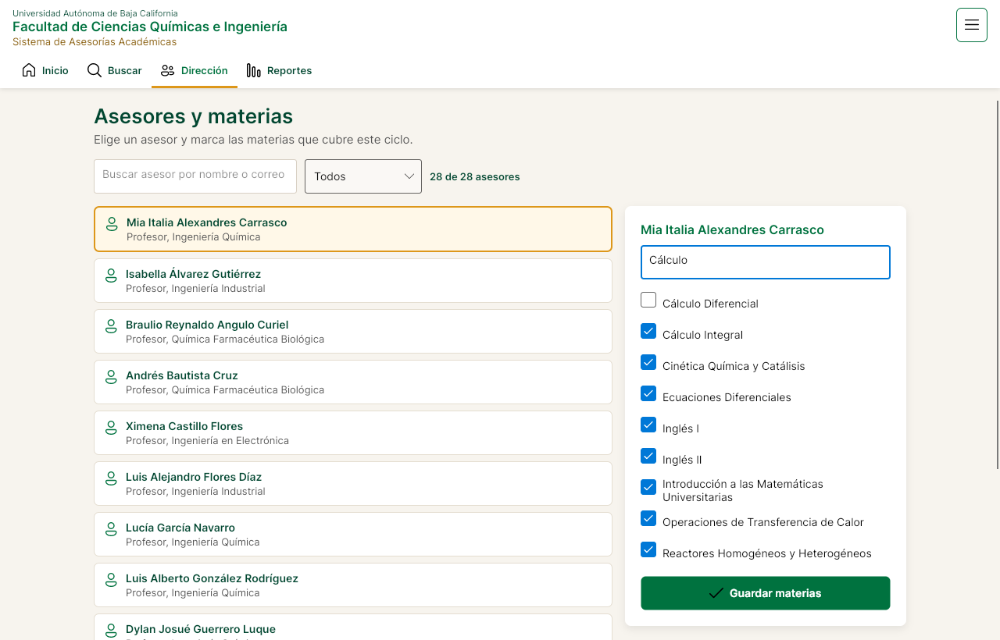

> No se puede quitar una materia que ya tiene asesorías registradas en el
> ciclo. El sistema te dice cuáles son.

### 9.2 Consultar los reportes

Toca **«Reportes»**.

1. Elige el periodo en **«Creadas desde»** y **«Hasta»**.
2. Si quieres, filtra por **Asesor**, **Materia** o **Estado**.
3. Toca **«Ver métricas»**.

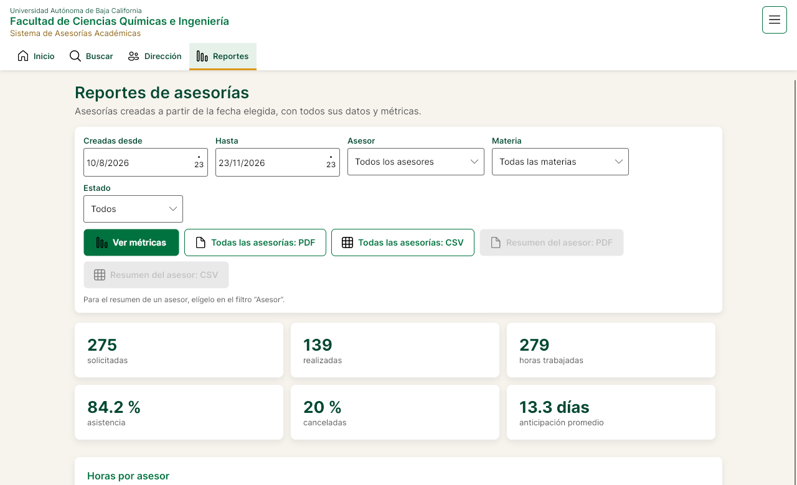

Verás:

- **Indicadores principales:** asesorías solicitadas y realizadas, horas
  trabajadas, porcentaje de asistencia y de cancelación, y con cuántos días de
  anticipación piden las citas los alumnos.
- **Horas por asesor:** cuántas asesorías tuvo cada uno y cuántas horas
  trabajó.

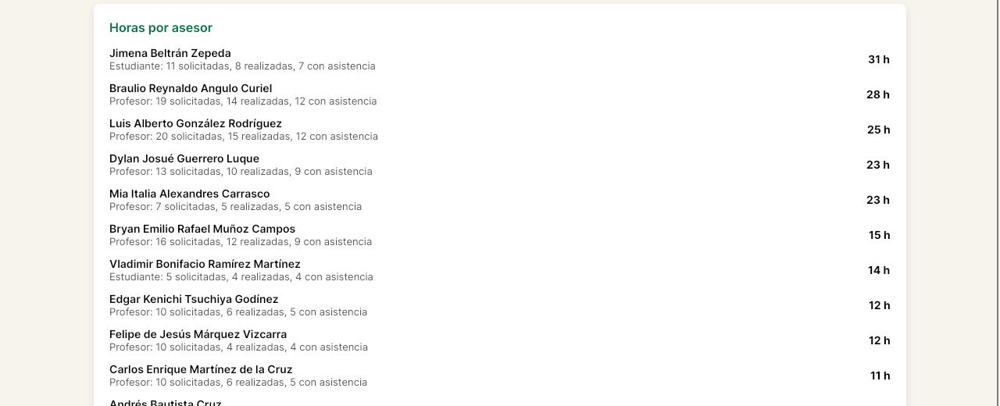

- **Demanda por materia, por día de la semana y por modalidad:** qué se pide
  más y cuándo.

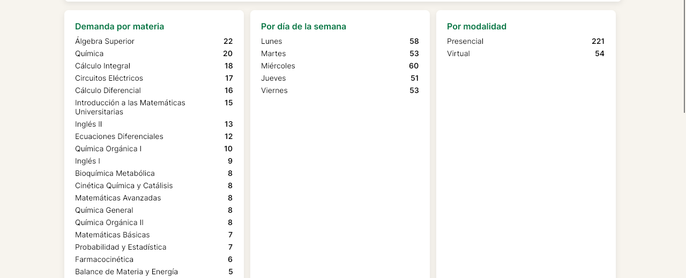

**Para descargar archivos:**

| Botón | Qué descarga |
|-------|--------------|
| **Todas las asesorías: PDF** | Documento con las métricas y el detalle de cada asesoría del periodo. |
| **Todas las asesorías: CSV** | Tabla con todos los datos, para abrir en Excel u Hojas de cálculo. |
| **Resumen del asesor: PDF / CSV** | El resumen de un solo asesor. Primero elige al asesor en el filtro «Asesor». |

---

## 10. Usarlo en el celular

El sistema funciona en el navegador del celular; **no necesitas instalar
ninguna aplicación**. Abre la misma dirección de la página.

En pantallas angostas el diseño se acomoda solo:

- El **menú de secciones** pasa a la **parte de abajo** de la pantalla, como
  pestañas con ícono.
- Los recuadros se apilan uno debajo de otro: primero la lista y después los
  filtros.

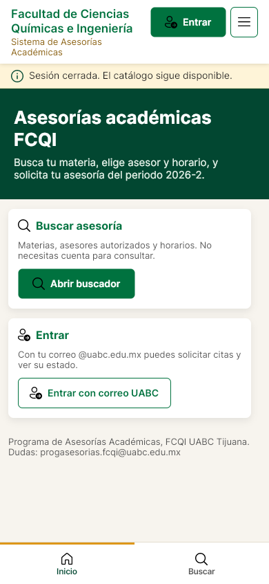 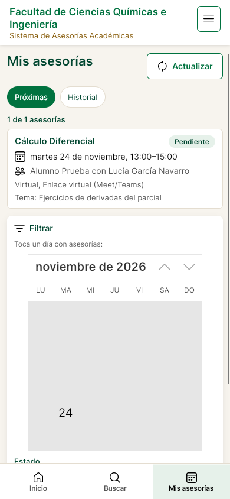

Todo lo demás funciona igual que en la computadora.

---

## 11. Salir del sistema

Si usas una computadora compartida (por ejemplo, en un centro de cómputo),
**siempre sal al terminar**:

1. Toca **☰** (arriba a la derecha).
2. Toca **«Salir»**.

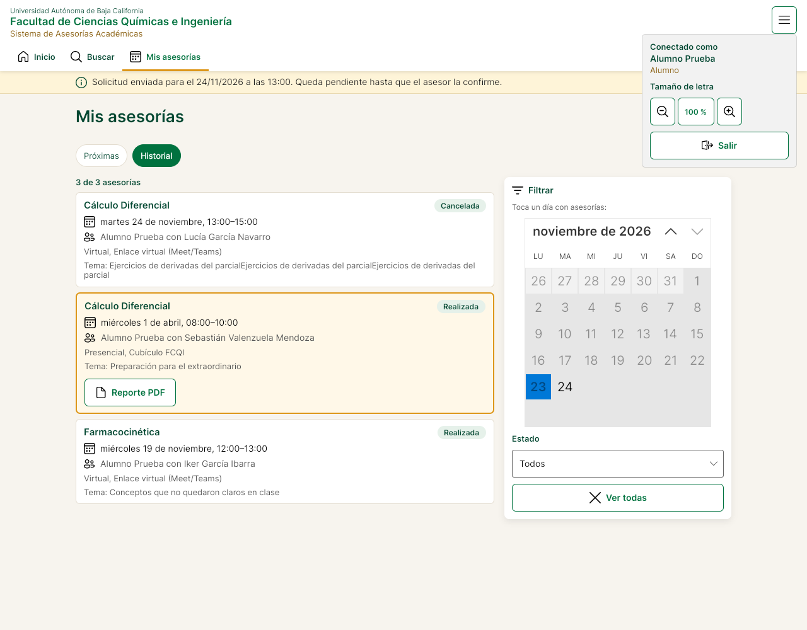

El sistema borra tus datos de la pantalla y vuelve al inicio con el aviso
*«Sesión cerrada. El catálogo sigue disponible.»*

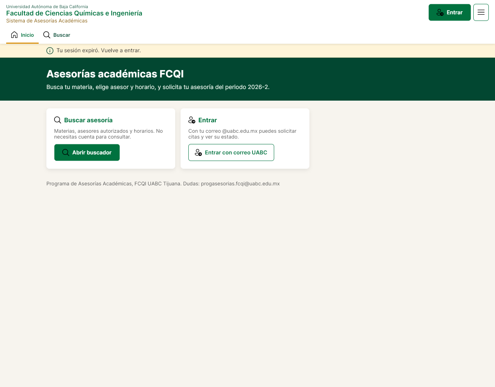

---

## 12. Preguntas frecuentes y problemas comunes

**La página se queda en «Cargando asesorías…» o dice «No se pudo abrir la
aplicación en este navegador».**
Actualiza tu navegador (Chrome, Safari, Edge o Firefox recientes) y recarga la
página. Si sigue igual, prueba con otro navegador.

**Me dice que mi correo no está dado de alta.**
Tu correo es correcto, pero la coordinación aún no te registra. Escribe a
progasesorias.fcqi@uabc.edu.mx.

**No encuentro mi materia.**
Toca «Limpiar filtros». Si sigue sin aparecer, desmarca «Solo con asesores
disponibles»: si la materia aparece así, es que todavía no tiene asesor
asignado.

**Elegí una materia y dice que no hay asesores.**
Dirección aún no asigna asesores a esa materia. Prueba con otra o pregunta a la
coordinación.

**El calendario no me deja elegir un día.**
Solo se pueden elegir los días en que el asesor tiene ese horario, a partir de
mañana y dentro del ciclo escolar.

**Me dice «Ese horario ya está lleno».**
Otros alumnos ya ocuparon el cupo para esa fecha. Elige otra fecha u otro
horario.

**Me dice «Ya tienes una solicitud activa en ese horario».**
Ya pediste esa misma cita. Revísala en «Mis asesorías».

**No me deja cancelar ni reprogramar.**
Faltan menos de 24 horas para la cita. Escríbele a tu asesor.

**Pedí una cita y no la veo.**
Ve a «Mis asesorías» y toca «Actualizar». Revisa también que estés en la
pestaña «Próximas» y que no tengas un filtro puesto (toca «Ver todas»).

**Soy asesor y no veo el botón «Registrar bitácora».**
Aparece solo en citas **confirmadas** que **ya empezaron**. Búscala en la
pestaña «Historial».

**Las letras se ven muy chicas o muy grandes.**
Toca ☰ y ajusta el «Tamaño de letra». También puedes usar Ctrl y + / − en la
computadora (Cmd en Mac).

**¿A quién le pido ayuda?**
Escribe a **progasesorias.fcqi@uabc.edu.mx**. Cuéntales qué estabas haciendo y
qué decía la franja amarilla de avisos.

---

## 13. Palabras que verás en el sistema

| Palabra | Significado |
|---------|-------------|
| **Asesoría** o **cita** | Reunión con un asesor para resolver dudas de una materia. |
| **Asesor** | Persona que da la asesoría: un profesor o un alumno avanzado. |
| **Asesor estudiante** | Alumno que también da asesorías. |
| **Horario** o **bloque** | Día y hora fijos en que un asesor atiende cada semana (por ejemplo, martes de 13:00 a 15:00). |
| **Cupo** | Cuántos alumnos pueden asistir a la vez en un horario. |
| **Modalidad** | Presencial (en la facultad) o virtual (por videollamada). |
| **Ciclo escolar** | El semestre en curso (por ejemplo, 2026-2). |
| **Bitácora** | Nota que deja el asesor al terminar: si el alumno asistió y qué vieron. |
| **Rol** | Papel con el que usas el sistema: Alumno, Asesor o Directivo. |
| **PDF** | Archivo para ver o imprimir, como un documento. |
| **CSV** | Archivo de tabla que se abre en Excel u Hojas de cálculo. |
| **Filtro** | Opción que oculta lo que no te interesa para ver solo lo que buscas. |
